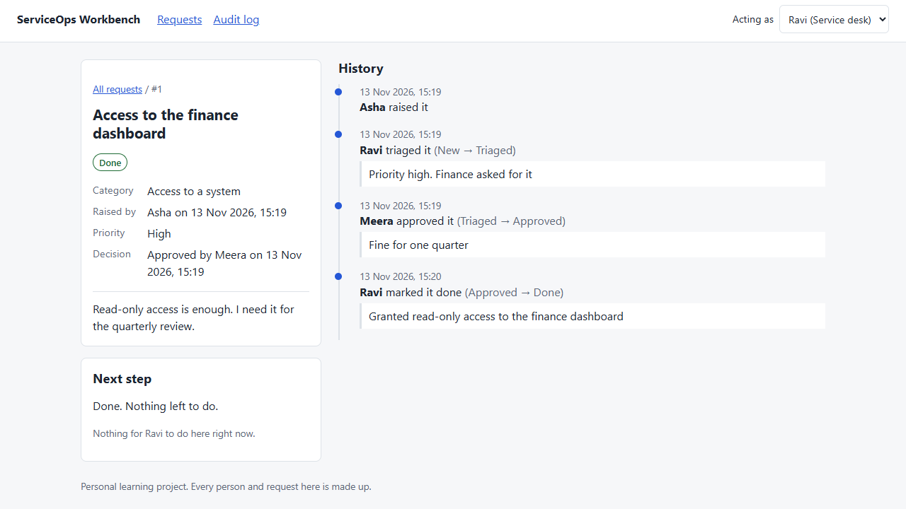
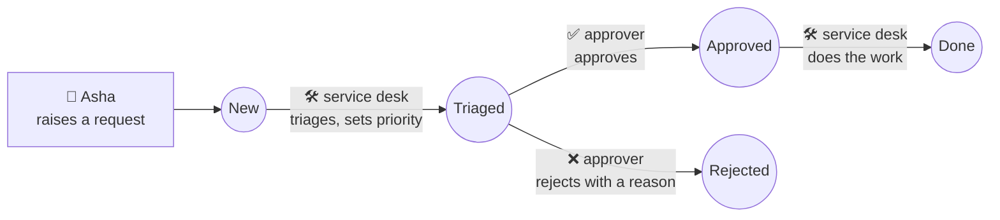
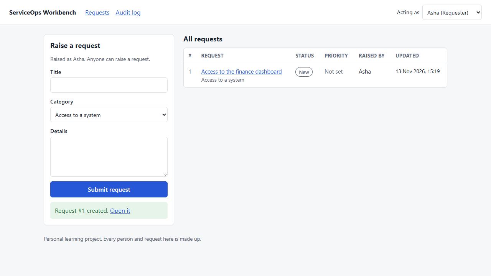
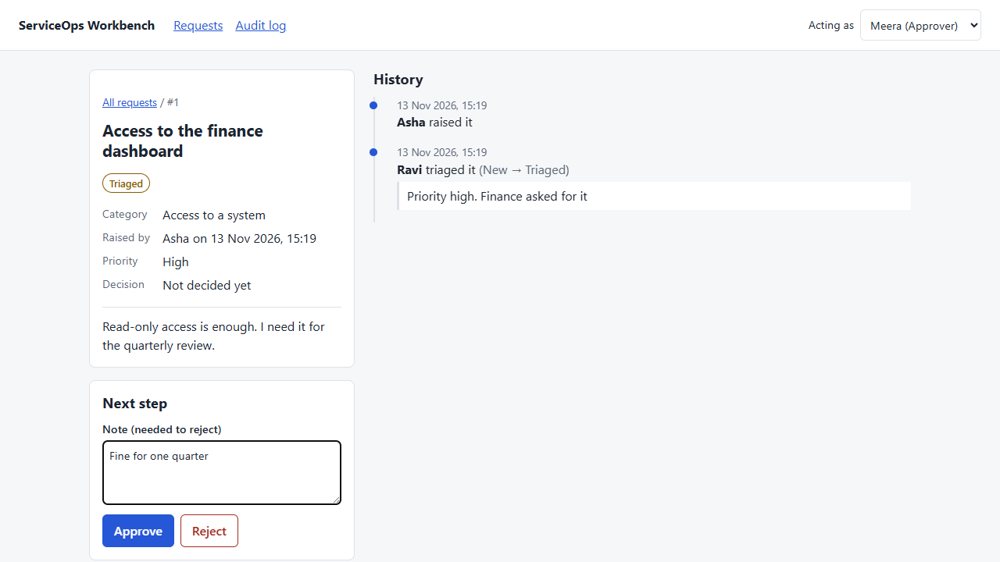
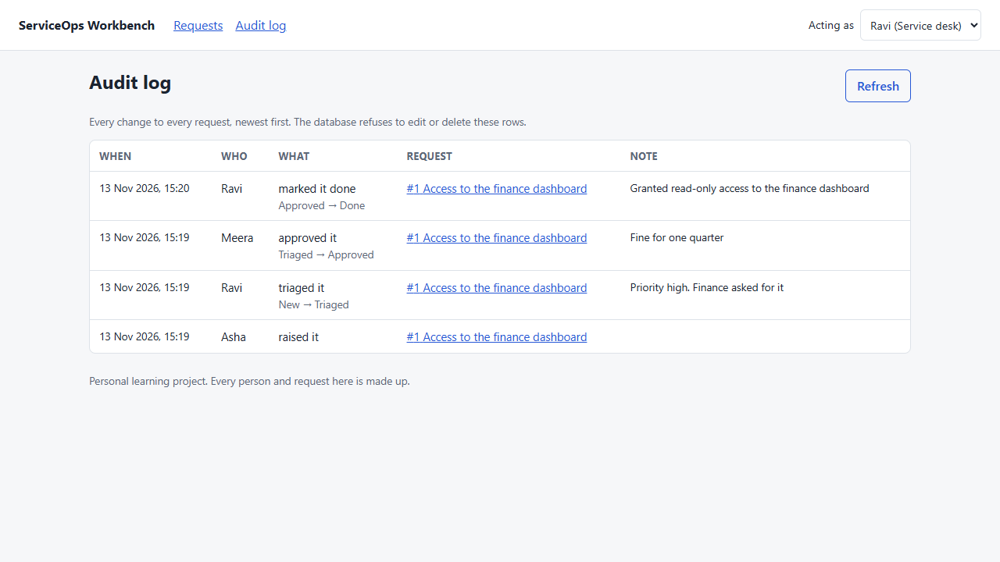

# serviceops-workbench

[](https://github.com/builtbyshailendra/serviceops-workbench/actions/workflows/ci.yml)


**A service request goes from intake to a human-approved action, and every step is written to an audit trail the database won't let anyone edit.**

> Personal learning project. Every person, team and request here is made up.



## Why

Plenty of internal work still runs on "send me an email and I'll sort it". Somebody asks for access, somebody else decides, a third person does the work, and months later nobody can say who approved what. The useful part isn't the form. It's making the approval explicit, refusing steps that skip it, and keeping a history you can trust.

## How it works



| Layer | Where | What it does |
|---|---|---|
| Frontend | [`frontend/`](frontend) | Next.js. Intake form, request list, a page per request with its next step and history, and the audit log |
| API | [`backend/app/main.py`](backend/app/main.py) | FastAPI. Creates requests, takes steps, returns history. Next.js forwards `/api/*` here |
| Rules | [`backend/app/workflow.py`](backend/app/workflow.py) | The status flow as plain Python: who may take which step, from which status, and what it needs |
| Database | [`backend/app/models.py`](backend/app/models.py) | PostgreSQL. Two tables, `CHECK` constraints for the key rules, and a trigger that makes the audit log append-only |

### Who can do what

| Step | From | Who | Needs | Records |
|---|---|---|---|---|
| Raise | | Anyone | Title and category | The request, as `new` |
| Triage | New | Service desk | A priority | The priority |
| Approve | Triaged | An approver who didn't raise it | | Who decided, and when |
| Reject | Triaged | An approver who didn't raise it | A reason | Who decided, and when |
| Complete | Approved | Service desk | A note on what was done | |

Every step also writes an audit event in the same transaction. Anything the rules don't allow comes back with a reason in plain words, such as `Can't approve a request that is new. It has to be triaged first.`

### Three layers of "no"

1. **The page** only shows the buttons the current person may use.
2. **The API** checks every rule again, so calling it directly doesn't get around them. Taking a step locks the request's row, so two approvers clicking at once are handled one after the other.
3. **The database** refuses the worst mistakes even if the API had a bug: a decision without who and when, approving your own request, and any edit or delete in the audit log.

## Screenshots

| Raise a request | Waiting for approval |
|---|---|
|  |  |



These come from the Playwright test, so they show the app as the test left it.

## Run it

You need Python 3.12, Node.js 20 or newer, and PostgreSQL 14 or newer.

```bash
# 1. A throwaway PostgreSQL on port 5433 (set PG_BIN if its tools aren't on PATH)
scripts/dev-postgres.sh start

# 2. The API on port 8000
cd backend
pip install -r requirements.txt
python -m uvicorn app.main:app --port 8000

# 3. The web app on port 3000, in another terminal
cd frontend
npm install
npm run dev
```

Then open http://127.0.0.1:3000 and use "Acting as" in the header to switch between Asha, Ravi, Meera and Tom. To use another database, set `DATABASE_URL`, for example `postgresql+psycopg://user@host:5432/serviceops`.

Two endpoints are for whatever runs the app. `/api/health` says the process is alive. `/api/ready` also checks the database. [deploy-baseline](https://github.com/builtbyshailendra/deploy-baseline) runs this app in Docker and Kubernetes and uses both.

### Tests

```bash
cd backend && pip install -r requirements-dev.txt && pytest -q   # needs a database whose name ends in _test
cd frontend && npx playwright install chromium && npm run e2e
```

The backend tests run against real PostgreSQL, because some rules live there. They drop and recreate every table, so they refuse to run unless the database name ends in `_test`. CI runs both suites on every push, each against a fresh PostgreSQL 16 container.

## What it doesn't do

- **No real login.** "Acting as" is a dropdown and the API trusts the header. A real version would put this behind single sign-on and read the person from a verified token.
- **No migrations.** Tables are created on startup. Changing a table means resetting the database; Alembic is the next step for that.
- **No notifications.** Nobody gets an email when a request is waiting for them.

## Build log

Built on 13 November 2026, one step at a time.

### Step 1: requests table and intake API

**Built:** a FastAPI backend on PostgreSQL. One table holds service requests; `POST /api/requests` creates one as `new`, and two `GET` endpoints list and fetch them. There's no login: four made-up people (a requester, a service desk agent and two approvers) and the caller says who they are in an `X-Acting-As` header.

**Decision:** the most important rules also live in the database as `CHECK` constraints: a request past triage has a priority, an approved or rejected request records who decided and when, and nobody decides their own request. If the API ever has a bug, PostgreSQL still refuses the bad row. Tests insert bad rows directly to prove it.

**What broke:** the script that starts a local PostgreSQL hung on Windows after the server was already up. The server outlives the script and had inherited its output pipe, so whatever read that pipe waited forever. Redirecting the server's output to `/dev/null` fixed it.

### Step 2: status flow and the approval step

**Built:** four steps, each with one role allowed to take it: the service desk triages (and sets a priority), an approver approves or rejects, and the service desk completes. Approving and rejecting are the human decision, so they record who decided and when. Rejecting needs a reason and completing needs a note on what was done. Every refusal says why in plain words, for example `Can't approve a request that is new. It has to be triaged first.` The rules live in one small file with no database, so they're easy to test on their own.

**What broke:** my first test for two approvers clicking at once was useless. It started both approvals together and expected one to win, but it passed five times out of five with the row lock turned off, because the two requests never really overlapped. The new test holds the row open the way a slow first approval would, then sends the second. With the lock, the second approver waits and gets `409`. Without it, the second approval quietly overwrites the first, and the test fails.

### Step 3: audit trail

**Built:** an `audit_events` table. Creating a request and every step write one event (who, what, from which status to which, the note and the time) in the same transaction as the change, so a change can't happen without its event. `GET /api/requests/{id}/events` returns one request's history and `GET /api/audit` returns everything, newest first.

**Decision:** the API never edits or deletes events, but that's only a promise. A PostgreSQL trigger makes it a rule: any `UPDATE` or `DELETE` on `audit_events` fails with `audit_events is append-only`. The foreign key also stops a request with history from being deleted. Tests try all three straight against the database.

**Learned:** the approval time on the request and the time on its audit event are exactly equal, not just close. PostgreSQL's `now()` is fixed at the start of a transaction, and both rows are written in one.

### Step 4: intake form and request list

**Built:** a Next.js frontend. The home page has a form to raise a request and a table of every request with its status, priority and who raised it. An "Acting as" picker in the header replaces a login; it's remembered in the browser and sent with every API call. Next.js passes `/api/*` on to FastAPI, so the browser sees one origin and there's no CORS setup.

**Decision:** pinned TypeScript to 5.9. The newest release is TypeScript 7, the rewrite in Go, and I'd rather not find out mid-build whether Next.js's type checking works with it yet.

### Step 5: request page and audit log page

**Built:** a page for each request with its details, a "Next step" panel and its full history. The panel only shows the buttons the current person may use, based on `allowed_actions` from the API, and otherwise says who the request is waiting for. When an approver opens a request they raised, it says another approver has to decide. The audit log page lists every event across all requests, newest first.

**Decision:** the buttons are a convenience, not the rules. The API checks everything again, so someone calling it directly gets the same refusals. A Playwright test in Step 6 does exactly that.

### Step 6: Playwright test for the happy path

**Built:** one browser test that plays all four people: Asha raises a request, Ravi triages it, Meera approves it, Ravi marks it done, and the audit log shows the four events in order. A second test calls the API directly as Asha and checks that approving is refused with a clear reason. With `SCREENSHOTS=1` the first test also saves the screenshots used in this README.

**What broke:** nothing in the app, but the first screenshots were ugly. The test put a timestamp in the request title to stay unique across runs, and the Next.js dev badge sat in the corner. The test now finds its request by id instead of by title, and the badge is switched off.

**Decision:** the Chromium build already on my machine was older than the one this Playwright version expects. Instead of downloading another browser, the config reads `PW_CHANNEL`, so locally the test runs in Microsoft Edge. CI uses Playwright's own Chromium.

### Step 7: CI and this README

**Built:** a GitHub Actions workflow with two jobs, each with its own PostgreSQL 16 container. One runs the backend tests. The other installs the frontend, type-checks it, builds it for production and runs the Playwright tests in Chromium.

**Decision:** the CI database uses trust authentication instead of a password. The container lives only for the job and isn't reachable from outside, and it keeps a password, even a fake one, out of the repo.

### Step 8: ready to run as more than one copy

**Built:** two checks for whatever runs the app. `/api/health` only says the process is alive, and `/api/ready` also checks the database. Kubernetes restarts a copy that isn't healthy and stops sending traffic to one that isn't ready, so a database outage makes every copy not ready instead of restarting them all. The Python packages are now pinned to exact versions, and the test-only ones moved to `requirements-dev.txt`, so the container image doesn't carry pytest. The tests use `httpx2`, which Starlette now asks for. `BUILD_STANDALONE=1` builds the frontend as a self-contained server, for a smaller image.

**What broke:** the app creates its tables when it starts. I started three copies at the same moment against an empty database, 20 times, and 40 of the 60 starts failed with `duplicate key value violates unique constraint`. They all saw no tables and all tried to create them. A PostgreSQL advisory lock now makes them take turns. The test for it fails without the lock and passes with it.

**Learned:** Next.js reads `API_URL` when the app is built, not when it starts. The rewrite to the backend is written into the build output, so the address has to be right at build time.

## Next

- Alembic migrations, so the schema can change without resetting the database
- `deploy-baseline`: Docker images, one-command `docker compose`, and Kubernetes manifests with health checks for this app
- A real login with single sign-on, reading the person from a verified token instead of a header
